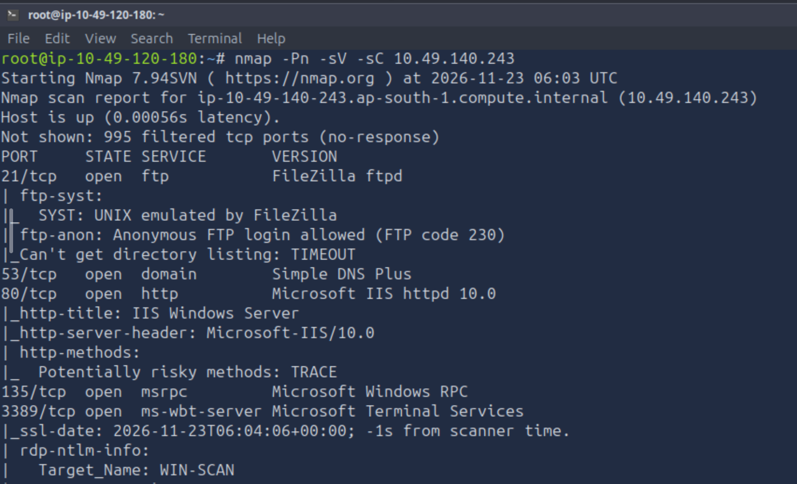
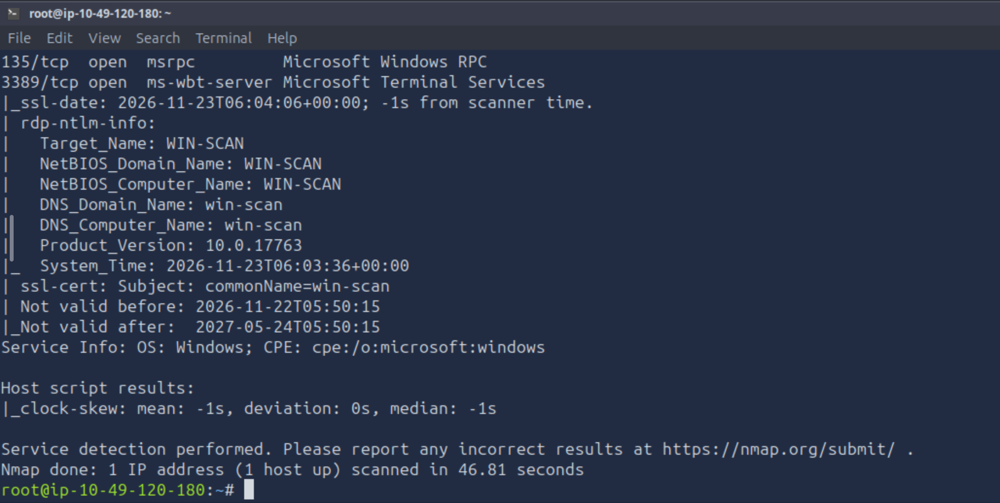

# Project 1: Network Service Enumeration and Vulnerability Analysis with Nmap

## 1. Objective
The objective of this project was to perform authorized network reconnaissance, port scanning, and service version enumeration against an isolated Windows Server lab target (`10.49.140.243` / `WIN-SCAN`) using Nmap. By identifying open ports, running services, and default script outputs, the goal was to assess the target's exposed attack surface and recommend practical system hardening measures.

---

## 2. Environment and Tools Used
* **Practice Platform:** TryHackMe (*Nmap* Authorized Lab Environment)
* **Attacker / Scanner System:** TryHackMe AttackBox (Linux, IP: `10.49.120.180`)
* **Target System:** Windows Server (`WIN-SCAN`, Product Version `10.0.17763`, IP: `10.49.140.243`)
* **Primary Tool:** Nmap `7.94SVN` (`-Pn`, `-sV`, `-sC` flags)

---

## 3. Method (Step-by-Step)
1. **Environment Initialization:** Deployed both the AttackBox scanner VM and the isolated lab target machine (`10.49.140.243`) within the TryHackMe virtual network.
2. **Initial Host Discovery & Troubleshooting:** Executed an initial service scan (`nmap -sV -sC 10.49.140.243`). Nmap reported `Host seems down` because the target firewall blocked default ICMP ping probes.
3. **Firewall Ping Bypass & Service Enumeration:** Re-ran the scan with the `-Pn` flag (`nmap -Pn -sV -sC 10.49.140.243`) to treat the host as online, identify service versions (`-sV`), and execute Nmap Scripting Engine (NSE) default security checks (`-sC`).
4. **Result Analysis:** Reviewed the 5 open TCP ports, service banners, and script outputs to identify misconfigurations and unnecessary exposure.

---

## 4. Results and Evidence
The scan completed in 46.81 seconds, identifying 995 filtered ports and **5 open TCP ports** on `WIN-SCAN`:

| Port / Protocol | State | Service | Version / Details | Security Observation |
| :--- | :--- | :--- | :--- | :--- |
| **21/tcp** | Open | `ftp` | FileZilla ftpd | **Anonymous FTP login allowed** (FTP code 230) |
| **53/tcp** | Open | `domain` | Simple DNS Plus | DNS service exposed externally |
| **80/tcp** | Open | `http` | Microsoft IIS httpd 10.0 | Unencrypted HTTP; **TRACE method enabled** |
| **135/tcp** | Open | `msrpc` | Microsoft Windows RPC | Windows RPC endpoint exposed |
| **3389/tcp** | Open | `ms-wbt-server` | Microsoft Terminal Services (RDP) | Exposes NetBIOS/DNS host details via NTLM |

### Supporting Evidence
* **Figure 1:** Initial scan blocked by ICMP firewall filtering, resolved using `-Pn`:
  
* **Figure 2:** Service and script enumeration results (Ports 21, 53, 80, 135, 3389):
  
* **Figure 3:** RDP NTLM info and OS fingerprinting output:
  

---

## 5. What I Would Do Differently / Remediation Recommendations
If I were administering this Windows Server in a production environment, I would apply the following remediation steps to reduce its attack surface:
1. **Disable Anonymous FTP & Migrate to SFTP:** Turn off anonymous authentication in FileZilla Server immediately and replace plaintext FTP (port 21) with encrypted SFTP or FTPS.
2. **Restrict RDP Access (Port 3389):** Block port 3389 from untrusted networks using Windows Defender Firewall, require Network Level Authentication (NLA), and place RDP behind a VPN or jump host.
3. **Harden IIS Web Server (Port 80):** Disable the risky HTTP `TRACE` method to prevent Cross-Site Tracing (XST) attacks and enforce HTTPS with TLS certificates.
4. **Filter Internal Services (Ports 53 & 135):** Restrict RPC (port 135) and DNS (port 53) strictly to authorized internal subnets rather than exposing them broadly.
5. **Scanning Improvement:** Next time, I would also run a full port range scan (`-p-`) and save machine-readable outputs (`-oA`) to ensure no high-numbered non-standard ports are missed.
