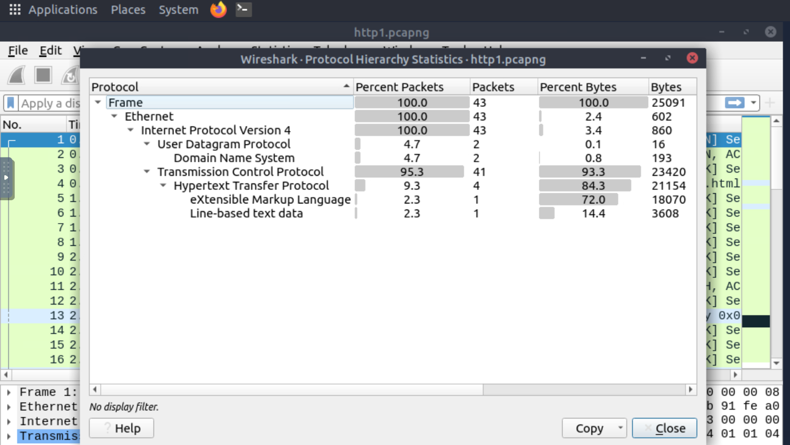
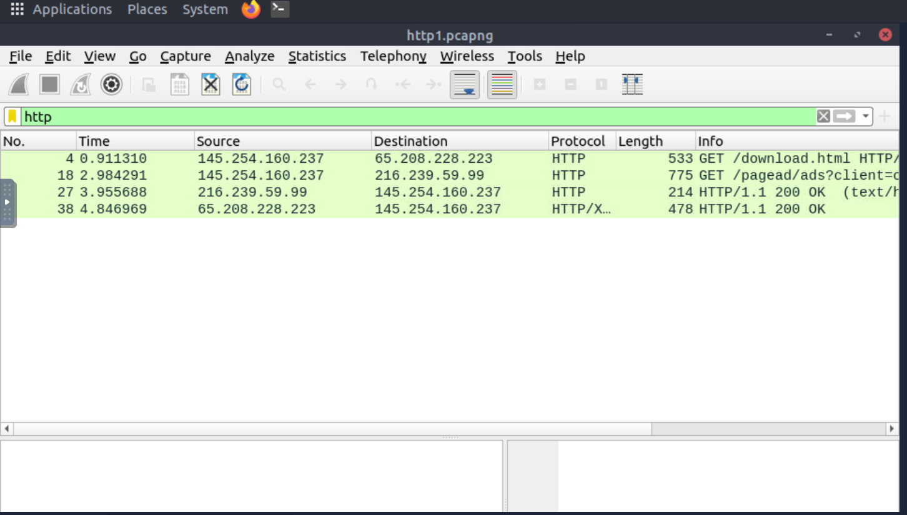
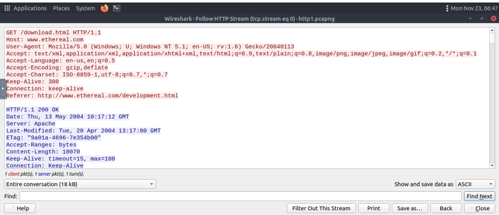

# Project 2: Network Packet Inspection and Unencrypted HTTP Traffic Analysis with Wireshark

## 1. Objective
The objective of this project was to inspect captured network traffic (`http1.pcapng`) using Wireshark to identify protocol distributions, isolate cleartext web requests, and reconstruct full application-layer HTTP conversations. By examining how unencrypted HTTP exposes client requests, user-agent strings, and server headers, the goal was to demonstrate why transport-layer encryption (HTTPS/TLS) is essential for protecting network confidentiality and integrity.

---

## 2. Environment and Tools Used
* **Practice Platform:** TryHackMe (*Wireshark: The Basics* Authorized Lab Environment)
* **Analysis System:** Ubuntu Linux Desktop (TryHackMe Lab Environment)
* **Primary Tool:** Wireshark (Packet Capture Analyzer)
* **Capture File Analyzed:** `http1.pcapng` (43 captured packets, 25,091 bytes)

---

## 3. Method (Step-by-Step)
1. **Capture Ingestion & Baseline Overview:** Opened `http1.pcapng` in Wireshark and reviewed the initial TCP three-way handshake (`SYN`, `SYN/ACK`, `ACK`) between client `145.254.160.237` and server `65.208.228.223` on port `80`.
2. **Protocol Distribution Analysis:** Opened **Statistics > Protocol Hierarchy** to examine the proportion of Layer 2–7 protocols across all 43 packets.
3. **Display Filtering:** Applied the `http` display filter to isolate application-layer web traffic from background TCP acknowledgments and DNS queries.
4. **Stream Reconstruction:** Right-clicked Packet 4 (`GET /download.html HTTP/1.1`) and selected **Follow > HTTP Stream** (`tcp.stream eq 0`) to inspect the complete cleartext request and server response headers.

---

## 4. Results and Evidence
Analysis of `http1.pcapng` revealed the following network and security findings:

* **Protocol Breakdown:** Out of 43 packets (25,091 bytes), **95.3% (41 packets)** used TCP, **4.7% (2 packets)** used UDP/DNS, and **9.3% (4 packets)** carried HTTP traffic accounting for **84.3% of total captured bytes**.
* **Filtered HTTP Activity:** Applying the `http` filter isolated four packets: two client `GET` requests (`GET /download.html` to `65.208.228.223` and `GET /pagead/ads...` to `216.239.59.99`) and two `HTTP/1.1 200 OK` server responses.
* **Cleartext Metadata Exposure:** Reconstructing `tcp.stream eq 0` exposed the full unencrypted HTTP request and response, including the target domain (`Host: ://ethereal.com`), referring URL (`http://://ethereal.com/development.html`), client OS and browser details (`Windows NT 5.1`, `Mozilla/5.0`), and web server software (`Server: Apache`).

### Supporting Evidence
* **Figure 1:** Protocol Hierarchy Statistics showing TCP, UDP/DNS, and HTTP distribution across `http1.pcapng`:
  
* **Figure 2:** Applying the `http` display filter to isolate web requests and `200 OK` responses:
  
* **Figure 3:** Reconstructed plaintext HTTP conversation (`Follow > HTTP Stream`) exposing headers and metadata:
  

---

## 5. What I Would Do Differently / Security Recommendations
Because unencrypted HTTP allows any passive observer on the network path to read requests, URLs, user-agent fingerprints, and session cookies in plaintext, administrators should apply the following protections:
1. **Enforce HTTPS Everywhere (TLS 1.2 / 1.3):** Migrate all web services from port `80` (HTTP) to port `443` (HTTPS) and enable HTTP Strict Transport Security (`HSTS`) so browsers never fall back to cleartext connections.
2. **Minimize Server Banner Disclosure:** Configure the Apache web server (`ServerTokens Prod` and `ServerSignature Off`) to suppress detailed version or platform headers in HTTP responses.
3. **Analytical Improvement:** Next time, I would also analyze a capture containing `HTTP POST` form submissions or encrypted `TLS` handshakes (`tls.handshake.type == 1`) to contrast plaintext credential exposure against encrypted SNI/certificate exchanges.
